# Diagrams

A `diagram` is a diagram written as text. You write [Mermaid](https://mermaid.js.org) or [Graphviz DOT](#graphviz-dot) source, and the engines draw it in the deck's own fonts and colors, so a flowchart, a sequence of messages or a mind map looks like the rest of the slide and not like a pasted screenshot. This guide covers when to use one, how to write it in JSON, YAML and Markdown, what it looks like, how it is sized, and how it exports. The field reference is [Content payloads](content-payloads.md#diagram); the schema definition is `$defs.Diagram` (`opf schema presentation '/$defs/Diagram'`).

## When to use a diagram

Choose the content kind by what the content is, not by how it should look.

| The content is | Use |
| --- | --- |
| Steps, a decision flow, systems and how they connect, messages between parties, states and transitions, a hierarchy, an entity model | `diagram` |
| Numbers plotted on axes or as shares of a whole, where the values should stay editable data | `chart` |
| Dated or ordered milestones with progress (`done`, `current`, `planned`) | `timeline` (the payload, with its status design) |
| Parallel entries with details, or a short sequence of one-line steps | a list (`items`) or layout `process` |

A Mermaid `pie` or `timeline` diagram is a quick picture. A `chart` or `timeline` payload keeps the data editable and gets the engines' chart and timeline design, with highlights and status words. Prefer the payload when it fits and the diagram when only a diagram can show the structure.

## Writing one

A string is shorthand for `{ "source": value }`. The object form adds `alt`, the text alternative, and `syntax`: `"mermaid"` (the default) or `"dot"` for a [Graphviz DOT](#graphviz-dot) graph. A diagram is a root payload, a block, or the content of a layout region that accepts it. It takes a `caption` like an image or a chart.

```json
{
  "title": "Every request is reviewed before it ships",
  "diagram": "flowchart LR\n  A[Request] --> B{Approved?}\n  B -->|yes| C[Build]\n  B -->|no| D[Revise]\n  D --> A"
}
```

The slide this draws, in the engine's default design:

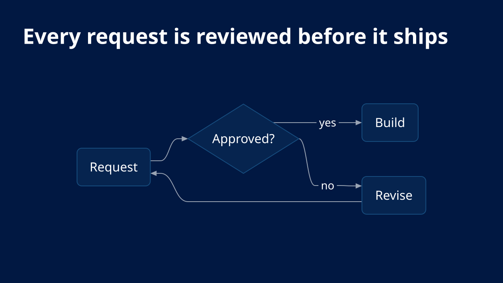

With an `alt` and a caption:

```json
{
  "title": "A rejected brief returns to its author",
  "diagram": {
    "source": "flowchart LR\n  A[Brief] --> B{Approved?}\n  B -->|yes| C[Build]\n  B -->|no| A",
    "alt": "A brief goes to review. Approved work is built; rejected work returns to the brief."
  },
  "caption": "Figure 1. The review loop"
}
```

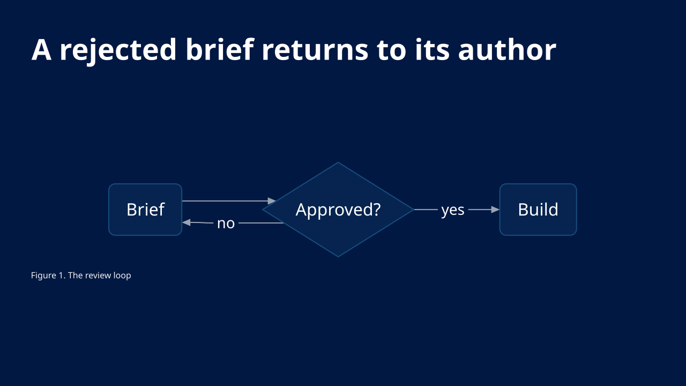

As YAML a block scalar keeps the source readable:

```yaml
- title: Every request is reviewed before it ships
  diagram:
    alt: A request is approved or revised, then built.
    source: |-
      flowchart LR
        A[Request] --> B{Approved?}
        B -->|yes| C[Build]
        B -->|no| D[Revise]
        D --> A
```

Beside text, give the slide `blocks`; the diagram takes its own cell:

```json
{
  "title": "The client talks to one API",
  "blocks": [
    { "bullets": ["The client creates a deck with one call", "The API validates it before it answers"] },
    { "diagram": "sequenceDiagram\n  Client->>API: POST /decks\n  API-->>Client: 201 Created" }
  ]
}
```

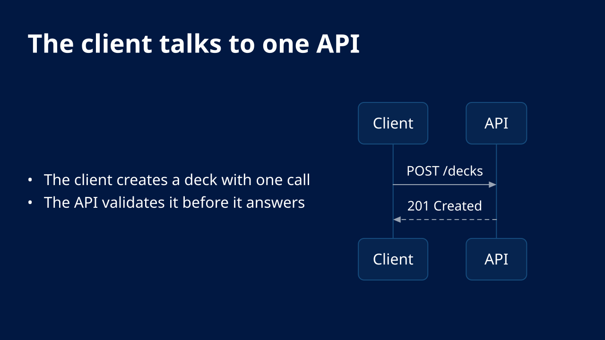

### In Markdown

A fenced block whose info word is `mermaid` is a diagram, and one whose info word is `dot` is a [DOT diagram](#graphviz-dot) (`{ source, syntax: "dot" }`). An optional `alt="..."` after the word is its text alternative. `toMarkdown` writes a diagram back the same way, so the round trip is lossless.

````markdown
# Every request is reviewed before it ships

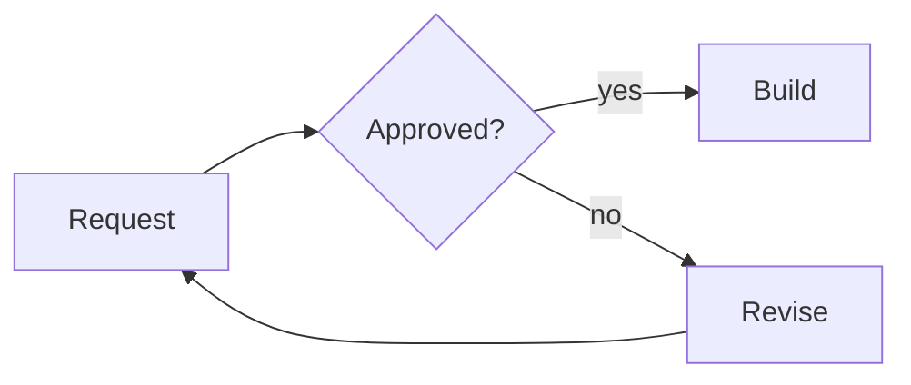
````

A source with a blank first or last line, or an `alt` that holds a backtick or a line break, cannot be written as a fence; the writer then uses an `opf-block`, which reads back exactly. See [Markdown and outlines](markdown.md). A runnable deck is [`examples/markdown/diagrams.opf.md`](../examples/markdown/diagrams.opf.md), and the JSON fixture [`examples/technical/diagrams.opf.json`](../examples/technical/diagrams.opf.json) has seven slides.

## Supported Mermaid families

OPF draws diagrams with [pele](https://pele.run), which parses Mermaid 12.1 syntax. The first line of the source names the family. All the built-in families are supported; ZenUML is not.

| Family | First line | Shows |
| --- | --- | --- |
| Flowchart | `flowchart LR` or `TB` | Steps, decisions and flow |
| Sequence | `sequenceDiagram` | Messages between participants over time |
| Class | `classDiagram` | Classes, members and relationships |
| State | `stateDiagram-v2` | States and transitions |
| Entity relationship | `erDiagram` | Entities, attributes and cardinalities |
| Gantt | `gantt` | Tasks on a calendar |
| Pie | `pie` | Shares of a whole |
| Quadrant | `quadrantChart` | Points on two axes |
| Mind map | `mindmap` | A hierarchy of ideas |
| Timeline | `timeline` | Periods with events, in sections |
| User journey | `journey` | Tasks with a satisfaction score |
| XY chart | `xychart` | Bars and lines on axes |
| Sankey | `sankey` | Flows between nodes |
| Git graph | `gitGraph` | Commits, branches and merges |
| C4 | `C4Context` and the other C4 headers | System context, containers, components |
| Block | `block` | Blocks on a grid |
| Architecture | `architecture-beta` | Services, groups and connections |
| Kanban | `kanban` | Columns of cards |
| Packet | `packet` | Bit fields of a protocol packet |
| Radar | `radar-beta` | Several measures on radial axes |
| Treemap | `treemap` | Nested rectangles sized by value |
| Venn | `venn-beta` | Overlapping sets |
| Ishikawa | `ishikawa-beta` | Causes of a problem (fishbone) |
| Requirement | `requirementDiagram` | Requirements and what satisfies them |
| Wardley map | `wardley-beta` | Components by visibility and evolution |
| Tree view | `treeView-beta` | A folder-style hierarchy |
| Event modeling | `eventmodeling` | Commands, events and views along a timeline |
| Railroad | `railroad-beta` (also `railroad-ebnf-beta`, `railroad-abnf-beta`, `railroad-peg-beta`) | The syntax of a grammar |
| Cynefin | `cynefin-beta` | Items placed in the Cynefin domains |
| Use case | `usecase-beta` | Actors, use cases and system boundaries |
| Swimlane | `swimlane-beta` | A flowchart in lanes |
| Agent flow | `agentflow-beta` | The steps and tools of an agent workflow |

The six most useful, each as a complete source and the slide it draws in the default design:

````text
flowchart LR
  A[Idea] --> B{Worth testing?}
  B -->|yes| C[Prototype]
  B -->|no| D[Park it]
````

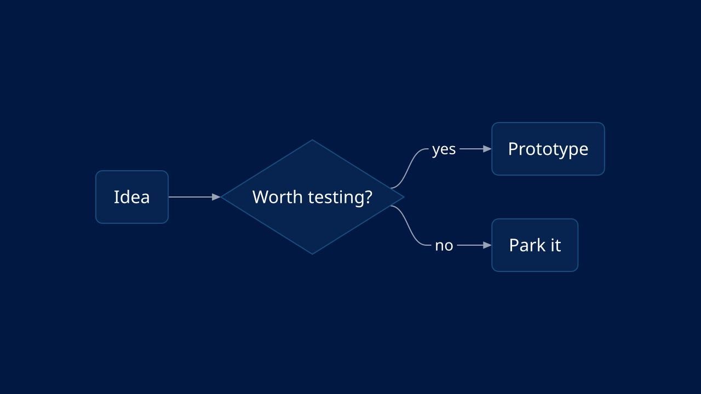

````text
sequenceDiagram
  Client->>API: POST /decks
  API-->>Client: 201 Created
````

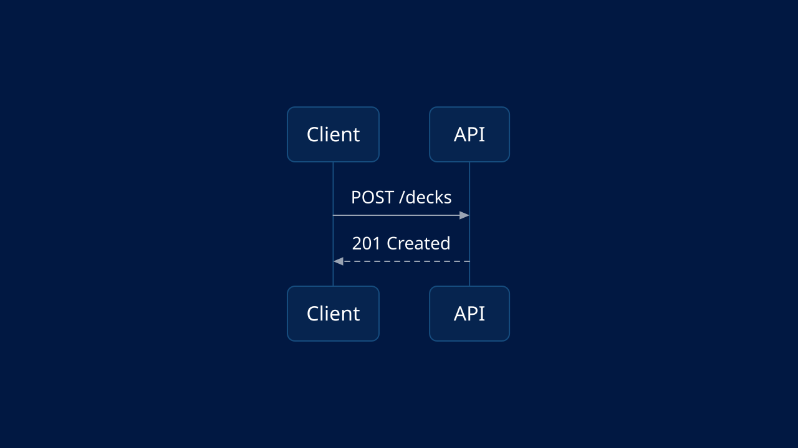

````text
mindmap
  root((Strategy))
    Growth
    Efficiency
    People
````

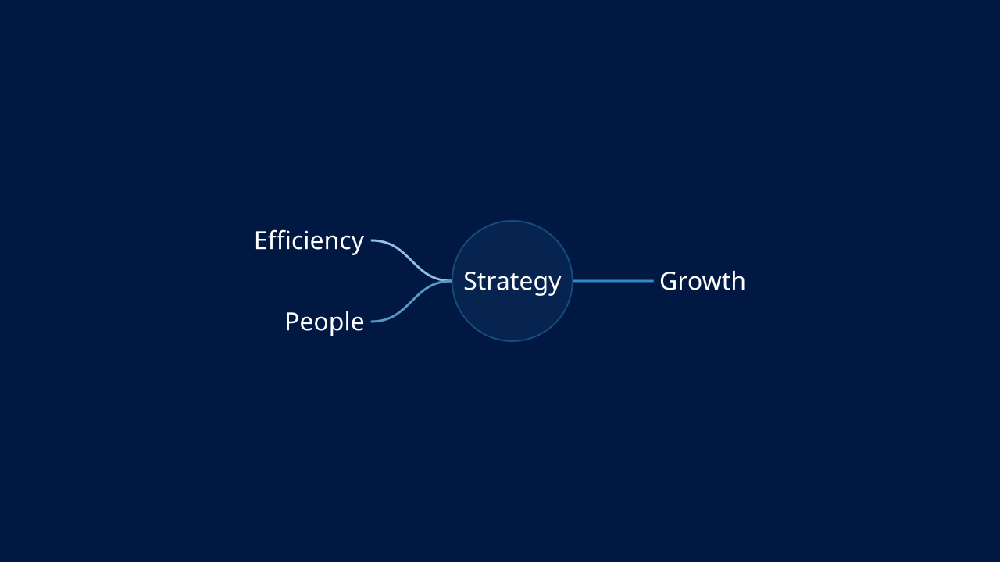

````text
timeline
  title Regional rollout
  section Pilot
    2026 Q1 : One operations team
  section Rollout
    2026 Q3 : All regions
````

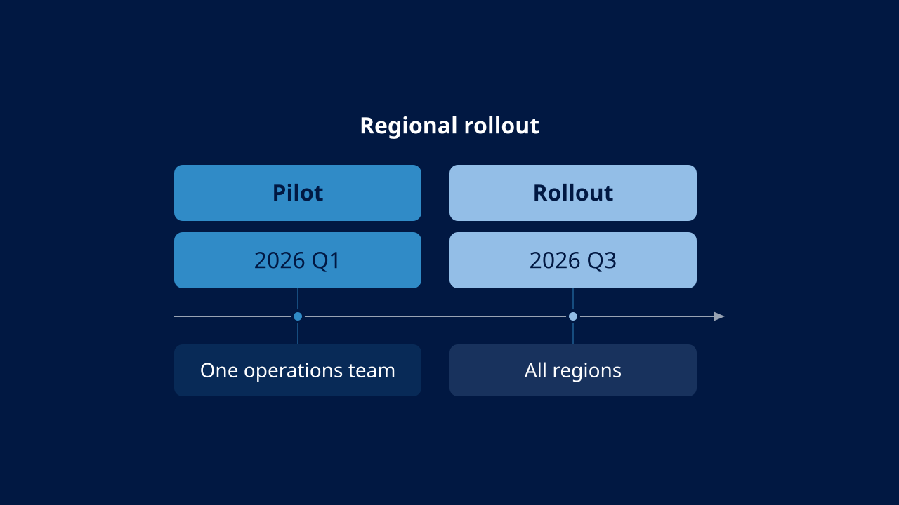

````text
stateDiagram-v2
  [*] --> Queued
  Queued --> Building
  Building --> Live: success
  Building --> Failed: error
  Failed --> Queued: retry
````

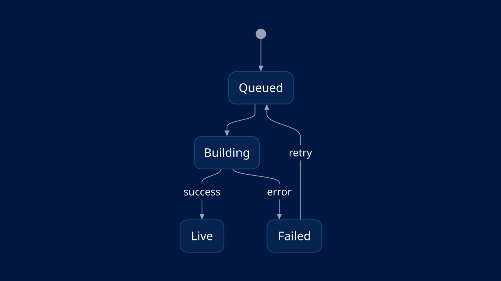

````text
journey
  title Onboarding
  section Sign up
    Create an account: 5: New user
    Verify the email: 3: New user
  section First week
    Build a first deck: 4: New user
````

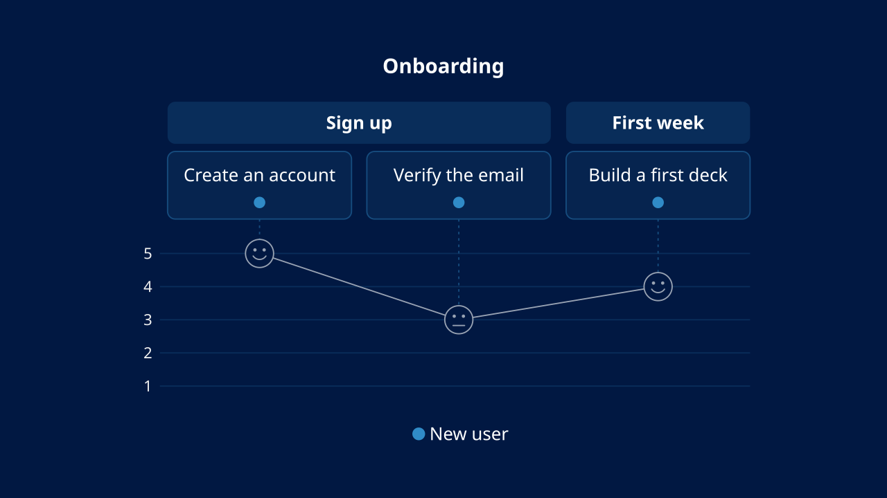

For the full syntax of each family, read the [Mermaid documentation](https://mermaid.js.org/intro/); pele follows it, but draws with its own layout (see [The engine](#the-engine)).

## Graphviz DOT

A [DOT](https://graphviz.org/doc/info/lang.html) graph (`graph` or `digraph`) is a diagram with `syntax: "dot"`. OPF reads the DOT language itself and gives the graph to pele's layered layout, the one that draws a Mermaid flowchart, so a DOT diagram is laid out in ranks as Graphviz's `dot` engine lays it out, sized, styled and exported exactly as a flowchart is. No Graphviz code ships or runs (Graphviz is EPL-2.0), and the drawing is pele's, so it does not match the pixels of a Graphviz rendering.

```json
{
  "title": "Every change passes the same pipeline",
  "diagram": {
    "syntax": "dot",
    "source": "digraph release {\n  rankdir=LR\n  node [shape=box, style=rounded]\n  subgraph cluster_ci {\n    label=\"Continuous integration\"\n    Commit -> Build -> Test\n  }\n  Review [shape=diamond, label=\"Approved?\"]\n  Test -> Review [label=\"passes\"]\n  Test -> Build [label=\"fails\", style=dashed]\n  Review -> Release [label=\"yes\"]\n  Release [shape=ellipse]\n}"
  }
}
```

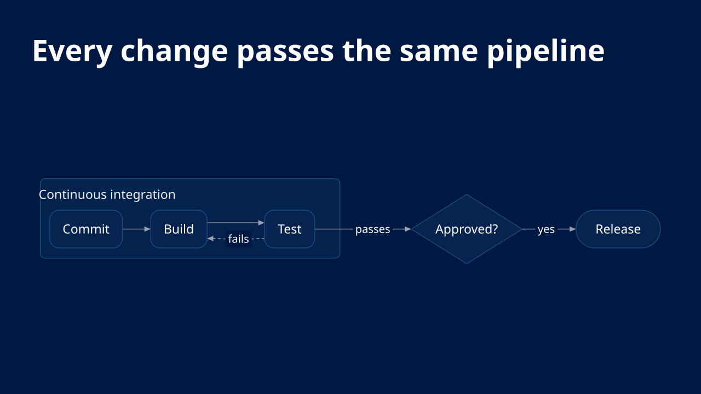

In Markdown, the `dot` fence:

````markdown
# A deck moves from draft to published

```dot alt="A draft is submitted for review; review approves it or sends it back."
digraph states {
  rankdir=LR
  node [shape=circle]
  Draft -> Review [label="submit"]
  Review -> Draft [label="changes"]
  Review -> Published [label="approve"]
  Published [shape=doublecircle]
}
```
````

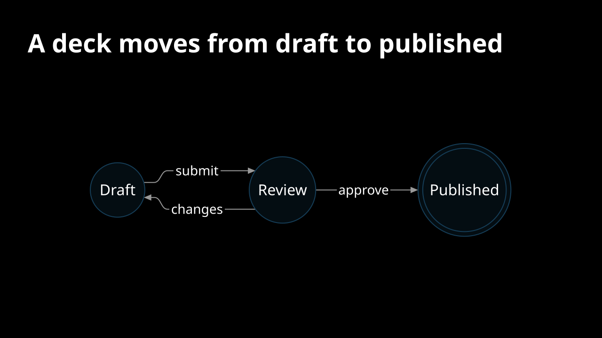

A runnable deck is [`examples/technical/dot-diagrams.opf.json`](../examples/technical/dot-diagrams.opf.json).

What OPF draws from a DOT source:

| DOT | Drawn as |
| --- | --- |
| `digraph` and `->`, `graph` and `--`, `strict` | Edges with an arrowhead in a digraph and without one in a graph; `strict` draws a repeated edge once |
| `rankdir` (`TB`, `LR`, `BT`, `RL`) | The direction the ranks run (top to bottom by default) |
| `label` on the graph | The diagram's title, drawn above it |
| `subgraph cluster_*` (or `cluster=true`) and its `label` | A labeled group around its nodes, nested as written; a node is in the innermost cluster that mentions it. Other subgraphs only group statements (`rank=same` is not kept) |
| `node [...]`, `edge [...]`, `graph [...]` | Defaults for the statements after them, scoped to their subgraph |
| Node `label` | The node's text: `\n`, `\l` and `\r` break lines, `\N`, `\G`, `\E`, `\T` and `\H` are the node, graph, edge, tail and head names; a record's fields (`{a\|b\|<p> c}`) are its lines; an HTML-like label is read as text (`<br/>` breaks a line) |
| Node `shape` | The shapes in the table below |
| Node `style` | `rounded` rounds a box, `dashed` and `dotted` dash the outline, `bold` thickens it, `invis` leaves the node and its edges out |
| Edge `label` (or `xlabel`) | The edge's label |
| Edge `style` and `penwidth` | `dashed` and `dotted` are a dashed line, `bold` or a `penwidth` of 2 or more a thick one, `invis` an edge that only places its nodes |
| `arrowhead`, `arrowtail`, `dir` | `none` is no marker, the `dot` and `odot` arrows a circle, `tee` and `box` a cross, every other arrow type an arrowhead; `dir=both` draws both ends (with the head's marker), `dir=none` neither, and `dir=back` draws the edge from its head to its tail, which the layout then ranks that way |
| `minlen` | The number of ranks the edge spans (up to 8) |
| Ports (`a:p:n`) | Read and not kept: the layout decides where an edge meets its node |

| DOT shape | Drawn as | PowerPoint shape |
| --- | --- | --- |
| `box`, `rect`, `rectangle`, `square`, `Msquare`, `record` | A rounded box | Rounded rectangle |
| `Mrecord`, `box` with `style=rounded` | A box with rounder corners | Rounded rectangle |
| `ellipse` (the default), `oval`, `egg` | A stadium, which holds its label as an ellipse does | Rounded rectangle (fully rounded) |
| `circle`, `Mcircle`, `doublecircle`, `point` | A circle, a double circle, a small filled circle | Ellipse |
| `diamond`, `Mdiamond` | A diamond | Diamond |
| `hexagon`, `octagon`, `doubleoctagon`, `tripleoctagon`, `septagon` | A hexagon | Hexagon |
| `parallelogram`, `trapezium`, `invtrapezium` | A parallelogram, a trapezoid, an inverted trapezoid | Parallelogram, trapezoid, freeform |
| `triangle`, `invtriangle` | A triangle, an inverted triangle | Triangle, freeform |
| `cylinder`, `note`, `tab`, `folder` | A cylinder, a card with a cut corner, a folder | Freeform |
| `box3d`, `component` | Stacked boxes, a framed box | Rounded rectangles and lines |
| `plaintext`, `plain`, `none`, `underline` | Text without an outline | Text box |
| Any other shape (`house`, `star`, `cds`, ...) | A rounded box | Rounded rectangle |

The deck decides colors, fonts and sizes, as it does for Mermaid: `color`, `fillcolor`, `fontcolor`, `fontname`, `fontsize`, `bgcolor`, `width`, `height`, `pos` and the other attributes of Graphviz's drawing are read and ignored, and so are `style=filled`, `constraint`, `weight`, `splines` and `rank`.

**Layouts OPF does not draw are refused, not approximated.** A graph whose `layout` attribute names another Graphviz engine (`neato`, `fdp`, `sfdp`, `circo`, `twopi`, `osage`, `patchwork`) is not drawn: the slide reports a finding at the attribute's line and column ("OPF draws DOT graphs with a layered layout, as Graphviz's dot engine does; the neato layout is not drawn ...") and the engines draw the "Diagram unavailable" placeholder. Remove the attribute, or write `layout=dot`, to draw the graph in layers. An HTML-like label that holds a `<table>` is refused the same way; write the label as text, or as a record.

A DOT source holds one graph, at most 20,000 characters and 500 edges, as a Mermaid source does. A syntax error is a finding with its line and column in the DOT source.

## How the deck styles a diagram

The deck decides colors and fonts, so a diagram follows the slide it sits on:

- **Node fills** are tints of the first accent of the slide's color scheme, in the slide variant's order, mixed over the surface the diagram sits on. That surface is the card when the block has one (see `emphasis` and cards in [Layout templates](layout-templates.md)), otherwise the slide background.
- **Outlines and connectors** mix toward the accent and the text color, with enough contrast to read as structure without competing with the labels.
- **Data series** (pie slices, xychart series, timeline sections, mind map branches and the like) use the same chart series palette as the slide's charts: the color scheme's accents in the variant's order.
- **Text** keeps 4.5:1 against its fill.
- **Fonts.** Labels use the font scheme's body font, and code-like labels (class members, for example) its code font.
- **Dark backgrounds, dark variants and color maps** adapt with no change to the source: `design.variant: "dark1"` on a slide redraws its diagram from the dark surface.

The same slide, with the same source, in four designs from the default catalog:

```json
{
  "title": "Every request is reviewed before it ships",
  "diagram": "flowchart LR\n  A[Request] --> B{Approved?}\n  B -->|yes| C[Build]\n  B -->|no| D[Revise]\n  D --> A\n  C --> E[Test]\n  E --> F{Passes?}\n  F -->|yes| G[Release]\n  F -->|no| C"
}
```

| `classic`, `forest-green`, `aptos` | `bold`, `deep-purple`, `montserrat` |
| --- | --- |
| 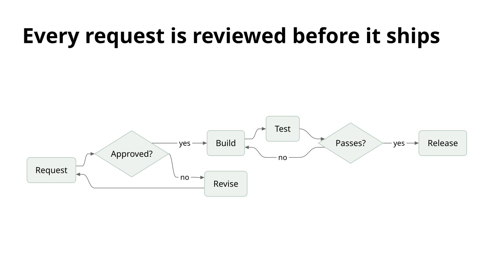 | 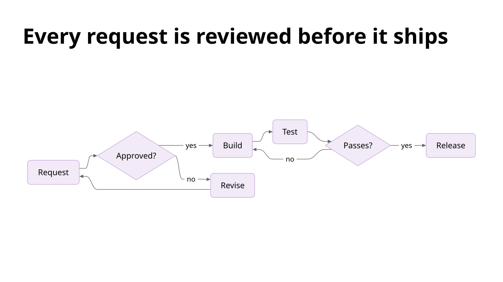 |
| **`minimal`, `burnt-orange`, `georgia`** | **`classic`, `steel-blue`, `open-sans`, slide `design.variant: "dark1"`** |
| 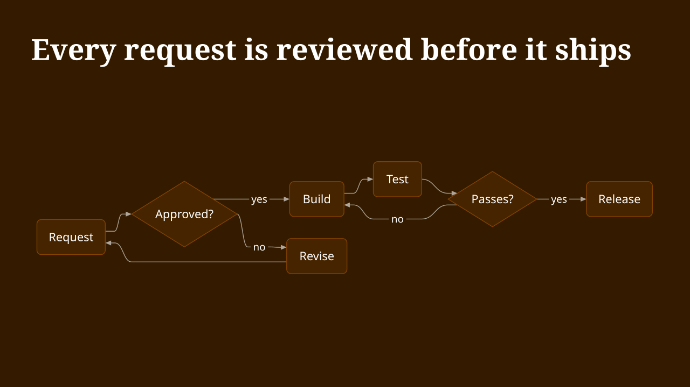 | 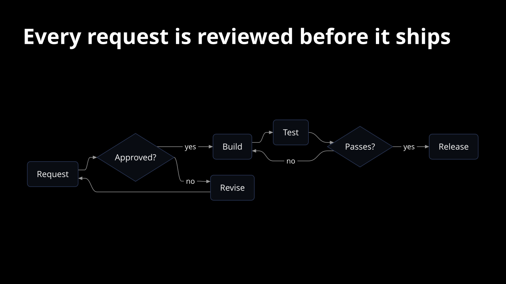 |

Every image in this guide is the renderer's own SVG output for the source above it, drawn by `scripts/build-diagram-doc-images.mjs` (`pnpm check:diagram-doc-images` keeps them current).

Mermaid's own theming (`%%{init: ...}%%`, themes, `themeVariables`) and click callbacks are ignored. Authored `style`, `classDef` and C4 `UpdateElementStyle` colors are the exception: pele applies them and OPF's painter keeps them, so a shape with an authored color no longer follows the deck's colors, variant or contrast rules. Leave them out and let the deck decide; if one shape must stand out, prefer a different node shape or a label to a color.

## Sizing

Core lays a diagram out for its block with the deck's measured fonts, the same way it fits text:

1. It tries the largest base size from 32 reference pixels down at which the drawing fits the block. A small diagram grows to the size of a list; a large one steps down.
2. Node labels never go below the readability floor (`minFontSize`, 16 reference pixels by default). The smallest secondary label (an edge label, an axis tick, a score) never goes below 75% of it.
3. A diagram is centered in its block. A region anchored to the bottom places it there.
4. Pele lays the diagram out for the width it has, so a smaller size is a new layout, not a shrunken picture: a wide flowchart may turn to run downward.

When the diagram does not fit even at the floor, a flowchart or a state diagram is first tried in the other main direction (`LR` and `TB` swap, `RL` and `BT` swap; a state diagram without a `direction` is top to bottom, so it tries `direction LR`). If the labels reach the floor there, the diagram is drawn that way and the slide reports an `arrangement-adapted` info finding ("The flowchart is drawn top to bottom because left to right does not fit at the readability floor"). This applies to a direction the author wrote too: the source keeps its text, only the drawing turns, and the preview and the PPTX export draw the same turned layout. A diagram that fits as written is never turned.

When no direction holds the labels at the floor (or the diagram type has no direction), the diagram as written is drawn smaller to stay inside its block, and the slide reports a `text-overflow` finding at the diagram's path, naming the directions tried. Fix it in the content, not in `minFontSize`:

- give the diagram a slide or a region of its own, or put it beside short text rather than under long text;
- split it into two diagrams, or shorten the labels.

The overflow check needs composition or rendering with the resolved fonts; `opf validate` alone cannot see it.

### Layouts that accept a diagram

A layout region lists the kinds it `accepts` ([Layout templates](layout-templates.md#regions)); `diagram` is one of them. In the default catalog these regions take a diagram:

| Layout | Region |
| --- | --- |
| `charts` | `chart` |
| `chart` | `chart-beside` |
| `media`, `image-beside`, `hero` | `image` |
| `comparison`, `two-column` | `first` and `second` |
| `three-column` | the three columns |
| `process` | `steps` |
| `timeline` | `timeline` |

A block binds to a region by kind, role and reading order ([Binding content to regions](layout-templates.md#binding-content-to-regions)); a slide that pins a diagram to a region that does not accept it gets the warning `opf/region-kind` and the block is bound by kind instead.

## Accessibility

`alt` is the text alternative: say what the diagram shows, not that it is a diagram ("A brief goes to review; approved work is built, rejected work returns to the brief."). Without `alt`, engines derive one from the diagram type and its labels (for example "Flowchart: Request, Approved?, Build, Revise"), up to 400 characters. The preview draws the diagram as one `role="img"` named by that text, and the PPTX export writes it as the description of the picture (or of the group of shapes).

## Exports

| Output | What you get |
| --- | --- |
| SVG preview | The diagram as vector shapes and text in the slide's colors and fonts |
| PNG | The preview rasterized |
| PDF | Vector; the diagram's labels stay selectable text |
| PPTX (the default, `diagrams: "shapes"`) | Native PowerPoint shapes, connectors and text in one group, drawn from the preview's own geometry, `alt` as the group's description. `fromPptx` brings an unchanged group back as a `diagram`, a DOT diagram with its DOT source. A diagram that cannot be written as shapes is the picture below. |
| PPTX, `diagrams: "picture"` | A native SVG picture with a PNG fallback: crisp at any size, recolorable as a picture in PowerPoint, `alt` as the picture's description. `fromPptx` brings it back as a `diagram`. |

### Native shapes in PowerPoint

The PPTX export writes each diagram as editable PowerPoint shapes that look like the preview (`diagrams: "shapes"`, the default). To get one SVG picture per diagram instead, as earlier releases did, opt out:

```js
const bytes = await toPptx(deck, { diagrams: "picture" });
await convert(deck, "deck.pptx", { diagrams: "picture" });
```

```sh
opf convert deck.opf.json deck.pptx --diagrams picture
```

The shapes are built from pele's laid-out drawing, the same geometry the preview draws, never a second layout or PowerPoint's connector routing:

- **Nodes** are shapes. An outline that is exactly a PowerPoint preset is that preset (`rect`, `roundRect`, `ellipse`, `diamond`, `hexagon`, `parallelogram`, `trapezoid`, `triangle`, checked against the [shape geometry](shapes.md)); any other outline (a cylinder, a flag, a stick figure, a pie slice) is a freeform of its exact path.
- **Labels** are real text in the deck's fonts at the preview's size, weight, color and baseline, with no wrapping and no autofit. A node's label is the node's own text, so it moves with the node; other labels are text boxes.
- **Edges** keep their exact path and arrowheads. A straight edge without arrowheads is a PowerPoint connector glued to the connection sites of the nodes it touches, so it follows a node you move. Every other edge is a freeform of its line and its arrowheads: PowerPoint opens a connector only with one of its preset routes (a connector of freeform geometry makes the file unreadable), and its largest line end is about a fifth shorter than pele's arrowhead, so a glued connector would not look like the preview.
- **Fills and lines** keep their colors, opacity, gradients, widths, dashes, caps and joins.
- Everything is one group named `OPF diagram N`, with the diagram's `alt` as its description.

A diagram family is written as shapes only after PowerPoint's drawing of it has been compared with the preview, source by source. Every family below passed: in PowerPoint 365 for Windows, with an example source per family (the ones in this guide where it has one) and a harder one (more nodes, long labels, right to left where the family has a direction), each slide rendered through PowerPoint and compared with the preview pixel by pixel and by eye, in five designs: the engine default (a dark slide in Aptos), a light theme, a serif font scheme (Georgia), a deck in Segoe UI, and a Japanese deck in Yu Gothic for the families that take labels (flowchart, sequence, mind map, timeline, kanban). In every design the shapes, lines and fills match the preview to antialiasing and every label sits where the preview puts it; what differs is the glyphs where the preview draws a font with a stand-in (see below).

| Family | Written as shapes | Family | Written as shapes |
| --- | --- | --- | --- |
| Flowchart | yes | Architecture | yes |
| Sequence | yes | Kanban | yes |
| Class | yes | Packet | yes |
| State | yes | Radar | yes |
| Entity relationship | yes | Treemap | yes |
| Gantt | yes | Venn | yes |
| Pie | yes | Ishikawa | yes |
| Quadrant | yes | Requirement | yes |
| Mind map | yes | Wardley map | yes |
| Timeline | yes | Tree view | yes |
| User journey | yes | Event modeling | yes |
| XY chart | yes | Railroad | yes |
| Sankey | yes | Cynefin | yes |
| Git graph | yes | Use case | yes |
| C4 | yes | Swimlane | yes |
| Block | yes | Agent flow | yes |

A DOT diagram is drawn as a flowchart, so it is written as shapes as a flowchart is. The list is core's `DIAGRAM_SHAPE_FAMILIES` (from `@openpresentation/opf/composition`). A diagram stays the picture, with the info finding `pptx/diagram-shapes-unavailable` naming its family and the reason, when:

- its family is not in that list (a new pele diagram type, until it has been compared);
- its drawing uses something PowerPoint has no native form for: a clip path, a mask, a filter, a pattern, an embedded image, text on a path, or right-to-left text (whose placement PowerPoint decides by its own bidirectional layout).

What can differ from the preview is what differs for all of the deck's text: where the preview draws a font with a stand-in (Aptos, Segoe UI and Yu Gothic, for example, which OPF does not bundle), PowerPoint draws the real font, so the glyph shapes and weight differ a little, while every line starts, ends and sits where the preview puts it. For a diagram that must be the preview to the pixel, export with `diagrams: "picture"`.

**Editing and import.** The shapes are ordinary PowerPoint shapes: restyle, move or retype them as you like. `fromPptx` reads an unchanged group back as the diagram, with its Mermaid or DOT source and the group's current description as `alt`. Once a member is moved, resized, retyped, added or removed, the group imports as its shapes and reports `invalid-diagram-provenance`: the edit is kept and the source is not reconstructed. To keep the source as the truth, edit it in OPF and export again. With `provenance: false` (`--provenance none`) the group carries no source and imports as its shapes.

PowerPoint's own "Convert to Shape" on a picture diagram also gives shapes, but that is PowerPoint's conversion, not an OPF export, and it does not map back to the diagram. See the [compatibility matrix](compatibility-matrix.md).

## Errors and limits

- A source that cannot be parsed reports a finding with its position in the source, for example `The diagram cannot be drawn (line 2, column 9): Expecting ...`, and the engines draw a "Diagram unavailable" placeholder in the block instead. Fix the source at that line and column.
- An empty source, a source over **20,000 characters** or a diagram with more than **500 edges** is refused the same way: a slide holds one readable drawing, not a document.
- In Markdown, an unknown attribute on the fence is `markdown/diagram-attributes`, and an empty fence is `markdown/diagram-source`.

## The engine

[pele](https://pele.run) 1.13.0 (MIT, no runtime dependencies) is the engine; OPF's own DOT reader (`dotToMermaid`, from `@openpresentation/opf/composition`, which shows the flowchart a DOT source becomes) hands it DOT graphs. It is synchronous and does not use the DOM, so the preview, the PDF and the PPTX export need no browser, and the drawing is deterministic for a given source and fonts. Core measures the text with the deck's fonts, so line breaks match the rest of the slide.

Node, Bun and Deno load every diagram type with core and draw any diagram at once. A browser bundle or an edge Worker (Cloudflare Workers, Vercel Edge) loads only pele's core with OPF (about 12 KB gzipped) and each diagram type the first time a deck draws one (13 to 54 KB gzipped each), through the package's `#diagram-engine` import map; a Worker that never loads a diagram type does not carry their code. The renderer's browser fonts handle loads them in `ensure` (its `pending` lists them as `diagram:<type>`), so `<opf-deck>`, the player, browser export and the editor wait for them as they wait for fonts; `toPptx` loads them itself. A host that validates or draws with `validate`, `composeSlide` or `toSvg` directly calls `await ensureDiagrams(presentation)` (from `@openpresentation/opf` or `@openpresentation/opf/composition`) first; `diagramsPending(presentation)` lists what it would load. Shapes and icon sets load the same way, and one preload covers all three: see [Engines and icon sets that load on demand](how-opf-works.md#engines-and-icon-sets-that-load-on-demand). Until then a diagram draws as a "Loading diagram" placeholder and its source is not checked, which is not a finding.

Pele reads Mermaid 12.1 syntax but has its own layout and drawing, so a diagram does not match the pixels of mermaid.js, and an unusual construct may parse in one and not in the other. Write for the OPF drawing: check a diagram in the preview (`opf convert deck.opf.json slide-{n}.png`), not in Mermaid's live editor.
