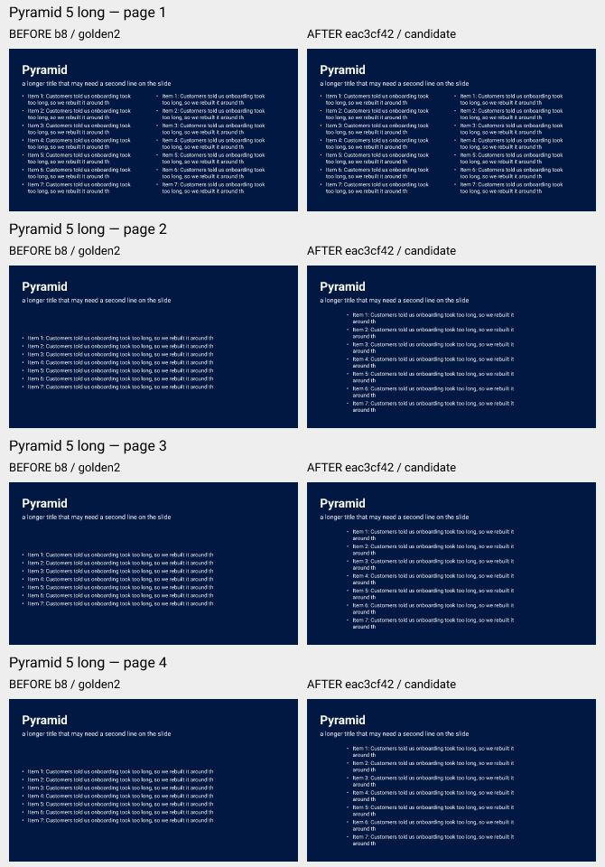

# LH-10: capped automatic-list reading measure

Issue [#1232](https://github.com/OpenPresentation/opf/issues/1232). The runtime candidate is **eac3cf42b3c82e5ac4a2af81c0db4cd1cb94b69f**; the assertion-only follow-up is **092feaef343e5864a4ca997c957bf2683c176ce7**. Root reviewed the runtime and the four-page sheet. C's peer review requested five nonvacuity assertions; they now require a nonempty painted list on every page, the same list count as returned blocks, and 35 actual geometry entries. Final metadata-only qualification passed five steps, with typechecking skipped and no product tests selected (31.3 seconds). Publication and merge belong to root.

Owned worktree: C:/opf-work/lh10-measure, branch codex/lh-10-capped-list-measure. Fresh origin/main was 9545016583ccfa151077cda4d51043ac6505a140, normally fast-forwarded to integration base b8fdd1cb88273a4f9963c9c01b89fbf1d5d5cc1b. No folded branch changed.

## Actual result

The valid paginated Pyramid5long continuation has a correct retained minFontSize:24, maxFontSize:24. After its diagram arrangement fails, it is ordinary list text. Exact SVG/PNG/byte comparisons bound all four BEFORE pages to the tracked b8 golden fixture before trusting measurements. Two existing public column oracles demonstrated 78→41-character lines at the same size.

The implemented fallback uses the existing whole-word fitter and keeps one narrower centered column:

| Page | Before maximum visible line | Candidate maximum | Actual body glyph size | Result |
| --- | --- | --- | --- | --- |
| 1 | 41 | 41 | 24 px | SVG and PNG unchanged |
| 2 | 78 | 68 | 24 px | Readable whole-word reflow |
| 3 | 78 | 68 | 24 px | Readable whole-word reflow |
| 4 | 78 | 68 | 24 px | Readable whole-word reflow |

All 35 entries, values, order and original pagination mappings remain exact. Continuation caps remain 24. No fit failure is added. The heading SVG groups and the full-size top 1280×190 pixel regions are exactly unchanged; a transient display impression is not a missing-heading finding.

The derivative sheet has eight native 320×180 panels. Every embedded panel's RGBA is independently checked against its source PNG. Source-bound full-size page-2 before/after PNGs, all eight SVGs/PNGs, geometry, mappings and the driver are in the lossless evidence archive.

## Decision and scope

**Vetoable decision LH10-CAPPED-MEASURE:** below the role size, an eligible default automatic list can adopt equally sized whole-word readable columns without requiring an increase that the cap forbids. An arrangement that actually failed can reuse retained-size whole-word fallback reflow. This preserves the justified 28→24 cap correction.

The implementation reuses the existing 70-character prose measure, minimum column measure, cap/type calculations, list slicing, rich fits and RTL ordering. There is no title, layout-id, fixture-key or text-string condition. Explicit payload/region counts, authored run values, fill:false and uncapped behavior retain their existing contracts; the explicit columns:auto selector policy is unchanged. An unsuccessful new optional trial leaves the prior result. Existing mandatory SH26 whole-word/overflow refusals remain strict.

The requested fontSize18 control uses **points**; its expected 24 reference pixels follow the existing unit conversion. This is not evidence of 18-pixel paint, an extra clamp, or physical PowerPoint fidelity. Optional nonfitting cases are not a universal readability certificate. LH-10 remains open for integration, E1/private comparison and native constraints; chart representation approval and release gates remain separate.

## Qualification and retained failures

- Initial focused test: 3 passed, 3 failed on unchanged b8 runtime. Final runtime controls: 10/10 passed. The assertion-only follow-up also passed 10/10 with relevant lint, without rebuilding or repeating the full core suite.
- Required mapped check at eac: **11/12 steps passed**, 222.5 seconds. Build, Biome, all eight selected repository checks and typechecking passed. Core reported **4,245 passed / 1 failed**; the sole failed script stopped before assertions because the sparse checkout omitted script-corpora.json. That unchanged script also reads browser.json.
- Exactly those two HEAD blobs were restored using exclusive writes, path containment, Git OID/SHA and unchanged-index guards. Only the failed, unchanged script then ran: **35/35 passed**. The original mapped RED and all 4,246 original results remain literal; this is not a second green mapped run.
- Biome's pre-existing size warning remains: composition.ts was already 1,053,583 bytes in b8, above its default 1 MiB limit; the candidate is 1,055,199 bytes. No lint threshold/configuration changed.
- The first diagnostic parser failure, intermediate development failures and offline packaging ENOBUFS are retained. The parser-only authorized recovery verified all four official SVG hashes before comparing oracles. Packaging increased only its child-process output buffer; no product limit changed.

Run the offline verifier with the pinned Node 24 entrypoint and the installed workspace dependencies: node docs/handoff/2026-11-09/lh10-capped-list-measure/verify.mjs. It binds the source/test commits, protected objects, all 104 original raw members, four follow-up members, original failure/recovery receipts, official BEFORE hashes, all 35 entries/mappings, eight exact sheet panels and unchanged heading pixels. No SVG/PNG is an authoritative new golden. Final metadata-only checks also passed; their seven raw members and original summary are appended separately. No native, Office, CI, provider, deploy or release action occurred in this lane.
