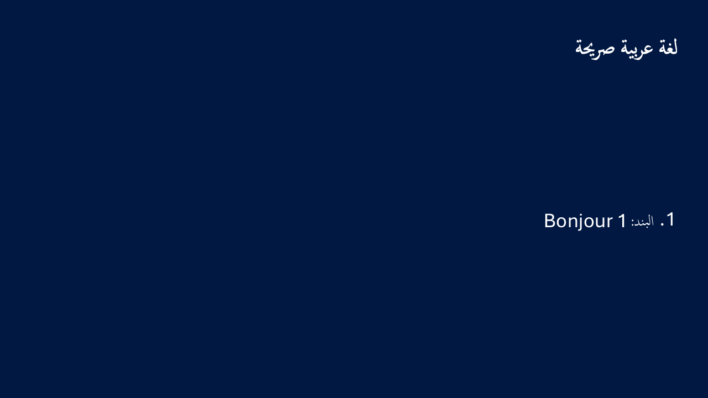
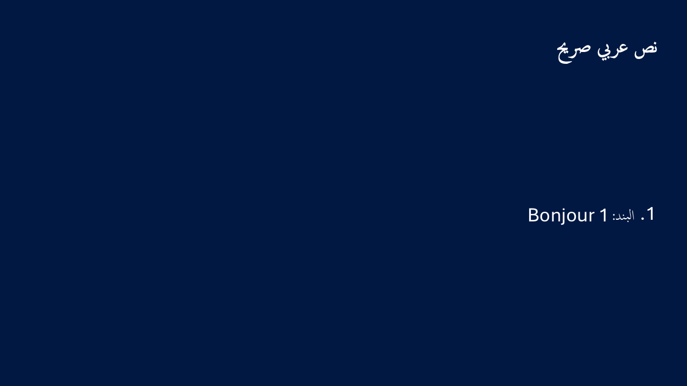

# Case05 and case06: exact current-source native images

These are two separately assigned, successful **read-only original / SaveCopy / reopen** native attempts from source `9a20aed56f2d1a762c3a88ab24f8cc25d849d61f` (tree `d3f3d7e5ea7b2e1687683a49a743894f680b42bf`), using frozen worker `6831f30a6ecec7ffec870e9aaf80dda27f2bab9a`. The six-package installed-consumer proof and closed-five suite are bound by full size/SHA256 in `receipt.json`; these are local genuine installed packages, not published 0.34.0.

The coordinator independently viewed both exact PNGs. The scoped positive observations are Bonjour/digit order, RTL marker punctuation, baseline and visibility of the whole four-shape case. Case05 was also viewed against the current Node focus reference. These observations do not establish exact cross-engine glyph outlines or pixel equivalence. Descriptor/range matching does not identify the physical glyph font file.

| Retained fact | Case05 | Case06 |
| --- | --- | --- |
| Actual exit / elapsed | 0 / 23.028s | 0 / 22.382s |
| Native phases / shapes each | 3 / 4 | 3 / 4 |
| Whole text UTF16 units | 31 = 15 + 7 + 8 + 1 | 28 = 12 + 7 + 8 + 1 |
| Probe targets / ranges / sampled UTF16 units, each phase | 3 / 3 / 16 | 3 / 3 / 16 |
| Style mismatches, each phase | Empty | Empty |
| Source imports, all phases | Equal | Equal |
| Import diagnostics, each phase | Empty | One retained `unsupported-body-font` |
| First postflight count / reported elapsed | 0 / 29.2334ms | 0 / 16.6311ms |
| Reported observer end | 57.4053ms | 25.9371ms |
| Exact PNG | 3,854 bytes | 3,913 bytes |

Each single attempt kept the unchanged 45-second worker budget: two owned read-only opens, one SaveCopy, two owned closes and Quit only with the owned application empty. There were **zero content, style or chart actions**. Each report has 1,350 stages (677 success, 673 begin). Strict typed complete admission preceded the unchanged, separate 5-second / 100ms / 51-query observer. Each observer recorded exactly one immediate zero sample. Successful Save/reopen is not an editing test.

Case06's diagnostic remains present in every import phase: script-specific faces cannot fit one OPF run family. It is retained without waiver, despite source equality and the positive scoped image observations. The 16 sampled units do not certify every unsampled unit's physical font; the whole image is distinct visual evidence.

## Exact images

All three images within each native attempt were byte-identical according to the coordinator's verified producing records. Only one original per case is copied here, unchanged. Both are 1280×720, with validated chunk bounds and CRCs. They contain only IHDR, sRGB, gAMA, PLTE, pHYs, IDAT and IEND chunks, with no EXIF or text metadata. `receipt.json` records each exact image hash, full envelope hash and reference-only observation/report hashes. No raw Windows report or base64 transcription file is included.

Case05:

Case06:

The older native03 failure, its transfer and all previous source/image records remain separate and unchanged. No broad 0.34, all-font, native editability or case09 result follows from this packet. Preparation of this metadata performed only local file identity/PNG structure reads and exact copying; no tests, builds, CI, native or Office execution occurred. Workstreams and burndown are unchanged. The coordinator will qualify the metadata in its next integrated delta.
