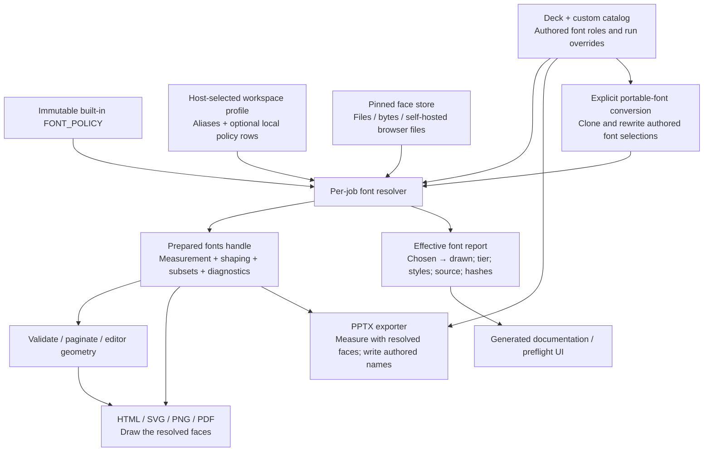

# Proposal: custom font profiles

Status: proposal, not a shipped API. The examples under “Available today” use existing APIs; the profile format and APIs under “Proposed extension” do not exist yet.

## Recommendation

Allow hosts to supply a reusable font profile for a workspace or organization. Keep a deck's authored font scheme separate from the host's replacement policy and font files. A scheme answers “which fonts did the author choose?”; a profile answers “which faces can this host load, and what should it draw when a chosen font is unavailable?” This supports brand fonts, private licensed fonts, offline deployments and new open families without modifying OPF's global policy for every customer.

Most of the first version already exists: inline and custom-catalog font schemes, caller-supplied faces, aliases, substitution policy, and a shared fonts handle. Document these before adding another document schema. The missing capability is a validated, reusable profile that can extend per-registry policy with provenance and measurements, drive lazy loading consistently in browsers and Node, and explain the effective routes.

## Architecture



The profile is supplied by the host, not silently activated by a downloaded deck. The global policy remains immutable. Every job resolves against a fixed effective profile; concurrent tenants cannot modify each other's rules. Browser loading, Node loading and the report use the same resolver, including language slots and glyph fallback.

## Available today

### 1. Choose a new family and supply its actual files

An inline scheme can use a font outside the built-in catalog. The host supplies each needed face. This example uses local files in a Node application; the browser loader accepts bytes and its own self-hosted URL/sha256 face entries.

```js
import {gallery} from '@openpresentation/gallery';
import {loadFonts} from '@openpresentation/opf-render/fonts-node';
import {toSvg} from '@openpresentation/opf-render';
import {toPptx} from '@openpresentation/opf-pptx';

const catalogs = [gallery];
const deck = {
  design: {
    fontScheme: {
      major: 'Acme Sans',
      minor: 'Acme Sans',
      code: 'Roboto Mono',
    },
  },
  slides: [{title: 'Quarterly review', text: 'Prepared with our brand font.'}],
};
const fonts = await loadFonts({
  pack: 'office',
  substitutionPolicy: 'none',
  faces: [
    {path: './fonts/AcmeSans-Regular.ttf', family: 'Acme Sans', weight: 400},
    {path: './fonts/AcmeSans-Bold.ttf', family: 'Acme Sans', weight: 700},
    {path: './fonts/AcmeSans-Italic.ttf', family: 'Acme Sans', weight: 400, italic: true},
    {path: './fonts/AcmeSans-BoldItalic.ttf', family: 'Acme Sans', weight: 700, italic: true},
  ],
});
const svg = toSvg(deck, 1, {fonts, catalogs});
const pptx = await toPptx(deck, {fonts, catalogs});
```

The preview draws Acme Sans and the PPTX names Acme Sans. Normal PPTX export still does not embed it: recipients need the family. Supplying font bytes does not grant redistribution rights. A host must enforce its license and embedding rules before serving, persisting or embedding private fonts; a font's name or a user-entered license label is not permission.

### 2. Override a preview replacement

An explicit alias works even for a family with no global policy row:

```js
const fonts = await loadFonts({
  pack: 'office',
  substitutionPolicy: 'visual',
  aliases: {'Acme Sans': 'Roboto'},
});
const svg = toSvg(deck, 1, {fonts, catalogs});
const pptx = await toPptx(deck, {fonts, catalogs});
console.log(fonts.substitutions);
```

The preview draws Roboto, while the PPTX continues to name Acme Sans. This is an explicit visual alias, not a new metric-compatibility claim. An exact loaded Acme Sans face takes precedence over the alias. To force Roboto in both preview and PPTX, change the authored scheme instead. `substitutionPolicy: 'none'` disables policy replacements, not explicit aliases or an explicit generic fallback.

### 3. Create a reusable catalog scheme

Hosts can register a custom catalog instead of adding a public Gallery record:

```js
const brandCatalog = {
  source: 'pkg:@acme/opf-catalog',
  fontSchemes: {
    brand: {name: 'Acme brand', major: 'Acme Sans', minor: 'Acme Sans', code: 'Roboto Mono'},
  },
};
const brandedDeck = {
  ...deck,
  catalogs: {acme: {source: brandCatalog.source}},
  design: {fontScheme: 'acme:brand'},
};
const brandCatalogs = [gallery, brandCatalog];
const svg = toSvg(brandedDeck, 1, {fonts, catalogs: brandCatalogs});
```

The catalog supplies design records; it does not supply font files. Register the same catalogs and use the same fonts handle for validation, pagination, preview and export. When saving a portable OPF, embed the required catalog records with core `embed`; font binaries remain a separate host resource.

## Proposed extension

### A scheme builder and replacement suggestions

Offer three clear actions in a font picker: use the actual supplied family, choose a preview substitute while preserving the authored name, or change the authored selection for editable exports. A scheme builder can generate a record from the user's heading, body and code choices and save it in their private catalog; it does not need to create a font binary. Show coverage, required styles and recipient availability before saving.

For a font with no known replacement, an optional local/private job can compare its licensed reference files against a host-approved inventory of open candidates. Rank candidates by script/glyph coverage, styles, advance widths and line metrics on representative corpora, using the same shaping engine as rendering. Report the reference and candidate hashes and worst-case width differences. Emit a suggested visual/unmeasured policy extension for review; promote it to metric only after the existing qualification rules and relevant native checks pass. Do not upload reference files to a public service or treat a single visual sample or a size adjustment as metric proof. Generating a font scheme or a replacement rule is the supported aim; inventing a new metric-compatible font program is a separate font-engineering project.

### A versioned host profile

Example proposed `.opf-fonts.json` (not an OPF deck field):

```json
{
  "format": "opf-font-profile/v1",
  "id": "acme-brand",
  "faces": [
    {
      "family": "Acme Sans",
      "weight": 400,
      "italic": false,
      "asset": "fonts/acme-regular.ttf",
      "sha256": "<verified 64-character SHA-256>",
      "rights": "private-use-only"
    }
  ],
  "aliases": {"Retired Acme Sans": "Acme Sans"},
  "policyExtensions": [
    {
      "family": "External Client Sans",
      "replacement": {"family": "Roboto", "compatibility": "visual"}
    }
  ],
  "substitutionPolicy": "visual"
}
```

The profile registers all required styles in practice; one face above keeps the example short. `asset` is an identifier the trusted host resolves, not a request for the renderer to fetch arbitrary URLs or read arbitrary paths. `rights` is an enforceable host restriction backed by verified licensing, not a grant. Missing files, hash mismatches, unsupported styles and missing glyphs are actionable diagnostics. A public redistributable profile permits only the project's approved licenses and verified provenance; a private profile can use a user's licensed files under the host's more restrictive delivery policy.

Proposed API:

```js
// Proposed names; not available in current packages.
const {fonts, report, effectivePolicy} = await prepareFontProfile({
  profile,
  presentation: deck,
  catalogs,
  resolveAsset: asset => privateFontStore.read(asset),
});
const svg = toSvg(deck, 1, {fonts, catalogs});
const pptx = await toPptx(deck, {fonts, catalogs});
```

Resolution precedence is exact loaded family, explicit profile alias, permitted effective-policy replacement and alternates, explicit generic fallback, then a located error. Alias targets must be actual loaded families; reject alias cycles and ambiguous rules. An exact family continues to win by default. A host that wants to replace an available family must make that a separate explicit operation, rather than quietly bypassing this precedence.

Effective-policy rows overlay built-ins by family within that profile only. A profile cannot weaken the host's license/embedding restrictions. User extensions start as `visual` or `unmeasured`; a `metric` tier requires qualification evidence for exact original/replacement file hashes, styles, scripts and shaping features. Do not infer metric equivalence merely from similar names, one sample, or a font-size multiplier.

The report includes each authored family, role, run path, resolved family and face, weight/italic, route source (exact, profile alias, profile policy, built-in policy or fallback), compatibility tier, missing styles/glyphs, size adjustment and the effective catalog/policy/profile/font hashes. It can feed the same table projection as the website, using the supplied effective policy; runtime results must also show actual loaded faces when an alternate or glyph fallback wins. A tenant-scoped cache key includes these identities, so an earlier tenant's face or changed file is never reused by name alone.

### Explicit portable-font conversion

Some users will want the replacement itself in editable exports, so recipients can install an open font instead of the proprietary original. Make this an explicit authoring operation:

```js
// Available today for a deck whose font selections are all in this inline scheme.
const portableDeck = structuredClone(deck);
portableDeck.design.fontScheme = {
  major: 'Roboto', minor: 'Roboto', code: 'Roboto Mono',
};
const pptx = await toPptx(portableDeck, {fonts, catalogs});
// The PPTX now names Roboto because the authored choice changed.
```

A future general conversion should return a cloned deck plus a patch and a loss/availability report. It must resolve and rewrite deck, slide, theme, heading/body/code/accent, script slots and run-level overrides, including text inside tables and charts; it must not do a string replacement over JSON or alter unrelated metadata. Show the affected selections before applying the patch, support undo, and record the original-to-portable mapping. Normal export retains the authored names. Rewriting to an open family does not automatically install or embed it in recipients' applications.

## Delivery and acceptance

1. **Document existing hooks:** publish tested examples for custom schemes, supplied faces and aliases, and explain why preview overrides do not rename PPTX fonts. No schema change is needed.
2. **Profile/resolver support:** add a schema, pure merge/validation layer and one effective per-registry policy lookup. Thread it through error messages, measurement, glyph fallback, browser `pending`/`ensure` lazy selection, shaping and subset selection. Do not update only Node's lookup while browsers retain static built-in rules.
3. **Reports and UI:** expose actual effective routes and missing resources; offer import/export of host profiles and shared organization presets. The document carries authored choices and optional inert profile identity, never executable loading instructions.
4. **Optional portable conversion:** implement structural font rewrites as a separately reviewed operation.

Acceptance requires two simultaneous tenants with different rules and no cross-contamination; unknown-family exact-face and alias cases; styles, scripts, glyph fallback and lazy browser loading; strict/visual policies; changed file hashes and cache invalidation; embedding-permission refusal; and preview/PDF/PPTX tests showing the intentional distinction between drawn faces and authored export names. Native application tests use a recorded installed-font inventory rather than assuming a universal missing-font replacement.
