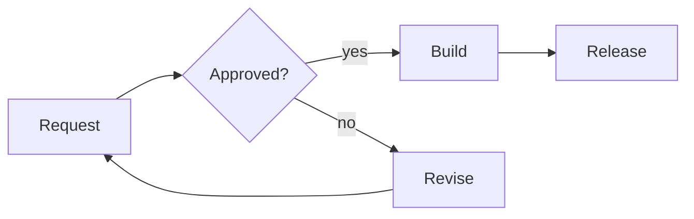
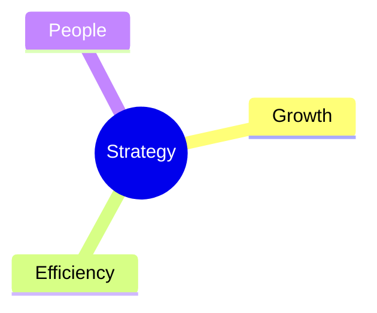

<!-- slide: id=flow -->
# Every request is reviewed before it ships



---

<!-- slide: id=api -->
# The client talks to one API

- The client creates a deck with one call
- The API validates it before it answers

```mermaid alt="The client posts a deck; the API validates it and answers 201 Created."
sequenceDiagram
  Client->>API: POST /decks
  API->>API: Validate
  API-->>Client: 201 Created
```

---

<!-- slide: id=ideas -->
# Strategy rests on three themes


